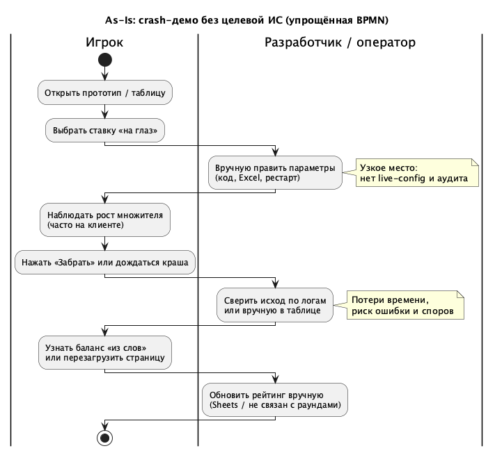
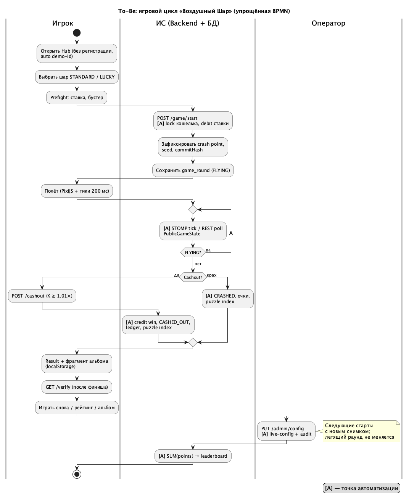
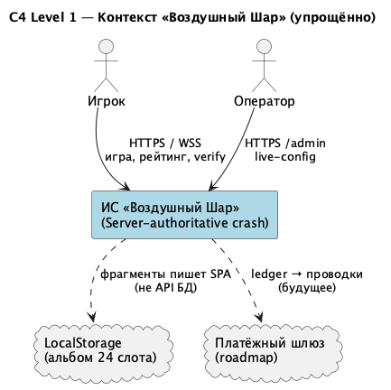
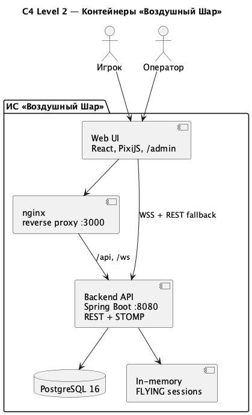
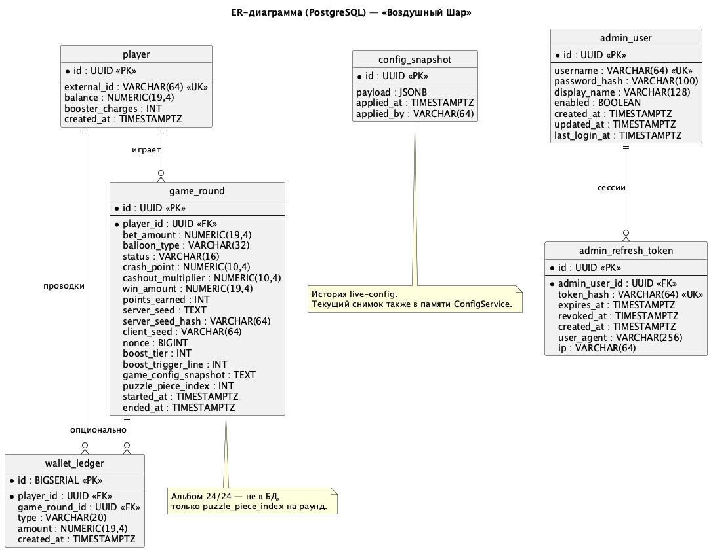

# Отчёт по проектированию информационной системы «Воздушный Шар»

**Предмет:** проектирование ИС, моделирование бизнес-процессов, архитектура и требования  
**Продукт:** веб-игра crash в стиле Victorian Steampunk (демо-кошелёк, provably fair, live-config)  
**Репозиторий:** `balloon-game`  
**Дата:** 2026

---

## Содержание

1. [Введение и цель работы](#1-введение-и-цель-работы)
2. [Этап 1. Анализ предметной области и бизнес-процессов](#2-этап-1-анализ-предметной-области-и-бизнес-процессов)
3. [Этап 2. Архитектура и модель данных](#3-этап-2-архитектура-и-модель-данных)
4. [Этап 3. Нефункциональные требования и ADR](#4-этап-3-нефункциональные-требования-и-adr)
5. [Перечень функциональных требований](#5-перечень-функциональных-требований)
6. [Перечень нефункциональных требований](#6-перечень-нефункциональных-требований)
7. [Журнал архитектурных решений (ADR)](#7-журнал-архитектурных-решений-adr)
8. [Заключение](#8-заключение)

---

## 1. Введение и цель работы

**Предметная область** — crash-игры: игрок поднимает коэффициент **K** во времени и должен нажать «Забрать» до момента краша. Типичные решения без целевой ИС страдают от однотипного UI, отсутствия доказуемой честности, ручной настройки баланса и слабого retention после проигрыша.

**Цель проектирования** — провести анализ предметной области, смоделировать бизнес-процессы As-Is / To-Be, спроектировать архитектуру и модель данных, зафиксировать функциональные и нефункциональные требования и архитектурные решения для ИС **«Воздушный Шар»**.

**Результат внедрения To-Be:** единый веб-контур (игрок + оператор), server-authoritative математика, PostgreSQL для кошелька и истории, real-time полёт (STOMP 200 мс + REST fallback), рейтинг по очкам, клиентский альбом из 24 фрагментов, админка с live-config без рестарта сервера.

---

## 2. Этап 1. Анализ предметной области и бизнес-процессов

### 2.1. Процесс As-Is (текущее состояние)

Без специализированной ИС crash-демо обычно опирается на правки кода или таблицы, клиентский или «доверительный» random, ручную сверку исходов и отдельный рейтинг. Это даёт узкие места: долгая настройка α и house edge, споры о честности, потери времени оператора, отсутствие связи раундов с рейтингом и коллекцией.

| Этап | As-Is | Проблема |
|------|-------|----------|
| Баланс игры | Код / Excel, рестарт | Нет аудита, риск ошибок |
| Игрок | Общая сессия или список id | Нет персонального ledger |
| Раунд | Клиент или непрозрачный скрипт | Нет PF verify |
| Исход | Логи / ручная таблица | Двойные списания, задержки |
| Retention | Не ведётся | Нет причины вернуться |

### 2.2. Процесс To-Be (целевое состояние)

После внедрения ИС участвуют роли **Игрок**, **Оператор** и **ИС (Backend + БД)**. Игрок проходит цикл Hub → Prefight → полёт → результат → повтор; ИС автоматизирует кошелёк, расчёт K и краша, cashout, очки, индекс фрагмента пазла, рейтинг и verify; оператор меняет конфиг через `/admin` с записью в `config_snapshot`. Летящий раунд не пересчитывается при смене конфига — снимок правил фиксируется на `POST /start`.

**Точки автоматизации:** debit/credit ledger; фиксация crash point и commitHash; STOMP/REST тики; terminal CRASHED/CASHED_OUT/VOID; leaderboard; аудит config.

### 2.3. Диаграмма бизнес-процесса As-Is

*Источник для экспорта:* `docs/bpmn/as_is.puml`

**Описание.** На диаграмме показан линейный процесс без интегрированной ИС: игрок действует в прототипе, разработчик или оператор вручную меняет параметры и сверяет исходы, рейтинг обновляется отдельно. Выделены узкие места (настройка без live-config, сверка по логам).

<!-- Вставьте изображение: docs/bpmn/as_is.png -->



*Рисунок 1 — Бизнес-процесс As-Is (упрощённая BPMN). Дорожки: Игрок; Разработчик / оператор.*

---

### 2.4. Диаграмма бизнес-процесса To-Be

*Источник для экспорта:* `docs/bpmn/to_be.puml`

**Описание.** Целевой процесс с пулами **Игрок**, **ИС**, **Оператор**. Автоматизированы старт раунда, трансляция состояния, cashout/крах, verify, обновление рейтинга и live-config. В легенде отмечены точки **[A]** — автоматизация.

<!-- Вставьте изображение: docs/bpmn/to_be.png -->



*Рисунок 2 — Бизнес-процесс To-Be с точками автоматизации.*

---

### 2.5. Связь процесса To-Be с функциональными требованиями

На основе диаграммы To-Be сформирован перечень функциональных требований (раздел 5): идентификация игрока и кошелёк (FR-01–FR-05), раунд и геймплей (FR-10–FR-20), бустеры и награды (FR-30–FR-34), рейтинг и прозрачность (FR-40–FR-42), админка (FR-50–FR-54), UI-экраны (FR-60–FR-63).

---

## 3. Этап 2. Архитектура и модель данных

### 3.1. Контекстная диаграмма (C4, уровень 1)

*Источник:* `docs/architecture/context_diagram.puml`

**Описание.** ИС «Воздушный Шар» представлена как единый программный продукт. **Игрок** взаимодействует по HTTPS/WSS (игра, рейтинг, verify). **Оператор** — HTTPS, админка, JWT. Внешние элементы: **LocalStorage** браузера (альбом 24 слота, не сервер БД) и **платёжный шлюз** (roadmap) для будущих проводок поверх ledger.

<!-- Вставьте изображение: docs/architecture/context_diagram.png -->



*Рисунок 3 — Контекстная диаграмма (C4 Level 1).*

---

### 3.2. Диаграмма контейнеров (C4, уровень 2)

*Источник:* `docs/architecture/container_diagram.puml`

**Описание.** Внутри границы ИС: **Web UI** (React 19, PixiJS, `/admin`), **nginx** (reverse proxy, один origin для игрока), **Backend API** (Java 21, Spring Boot — REST + STOMP), **PostgreSQL 16**, **In-memory** хранилище активных FLYING-раундов и rate limit. Клиент получает тики по WebSocket; при сбое — REST poll на тот же backend.

<!-- Вставьте изображение: docs/architecture/container_diagram.png -->



*Рисунок 4 — Диаграмма контейнеров (C4 Level 2).*

---

### 3.3. ER-диаграмма и модель данных

*Источник:* `docs/data/er_diagram.puml`  
*Миграции:* `src/main/resources/db/migration/V1__init.sql` … `V4__admin_auth.sql`

**Описание.** Ключевые сущности:

- **player** — `external_id`, баланс, `booster_charges`;
- **game_round** — ставка, тема, статус, PF-поля, очки, `puzzle_piece_index`, снимок конфига на старт;
- **wallet_ledger** — append-only проводки (ставка, выигрыш, refund, депозит);
- **config_snapshot** — аудит JSON конфига;
- **admin_user**, **admin_refresh_token** — оператор и сессии админки.

Связи: игрок 1—N раунды и проводки; раунд 0—N проводок; админ 1—N refresh-токенов.

**Нормализация:** модель приведена минимум к **3НФ** (атомарные атрибуты, зависимость неключевых полей только от PK, отсутствие транзитивных зависимостей между неключевыми полями в одной таблице). Состояние полёта в реальном времени и собранный альбом 24/24 сознательно вынесены из БД (in-memory и localStorage).

<!-- Вставьте изображение: docs/data/er_diagram.png -->



*Рисунок 5 — ER-диаграмма базы данных PostgreSQL.*

---

## 4. Этап 3. Нефункциональные требования и ADR

На этапе 3 зафиксированы измеримые NFR (раздел 6) по категориям: производительность (тики 200 мс), доступность (health, VOID при рестарте), безопасность (server-authoritative, JWT админа), масштабируемость (1 JVM + roadmap), UX (без регистрации, mobile lowDetail), сопровождаемость (Flyway, Testcontainers, OpenAPI).

Архитектурные компромиссы оформлены в журнале ADR (раздел 7): монолит vs микросервисы, PostgreSQL + STOMP с REST fallback.

---

## 5. Перечень функциональных требований

Функциональные требования выведены из процесса To-Be: система должна провести игрока от входа до повторной ставки, обеспечить честный crash на сервере, дать оператору управление балансом зала и сохранить след раунда в БД для рейтинга и проверки. Ниже требования сгруппированы по подсистемам; для каждого указано краткое пояснение смысла для пользователя или оператора.

Сводная таблица ID: [requirements/functional.md](requirements/functional.md).

### 5.1. Игрок и кошелёк

Демо-контур не использует классическую регистрацию: важно мгновенно начать игру, но при этом иметь персональный баланс и прозрачную историю движения средств — это основа доверия и будущих реальных платежей.

| ID | Требование | Пояснение |
|----|------------|-----------|
| FR-01 | Игрок по `external_id` без регистрации | Браузер хранит demo-id; барьер входа минимален |
| FR-02 | Welcome-баланс при первом обращении | Старт с 1000 ◎ — сразу можно лететь |
| FR-03 | Запрос баланса и зарядов бустера | UI показывает, на что хватит ставки и AUTO-бустера |
| FR-04 | Демо-пополнение при `allowDeposit=true` | Кнопка «+500» на Hub; в проде выключается конфигом |
| FR-05 | Журнал `wallet_ledger` | Каждая ставка, выигрыш, refund и депозит — отдельная проводка |

### 5.2. Раунд и геймплей

Ядро crash: сервер владеет математикой и исходом; клиент только отображает растущий K и отправляет cashout. Игрок должен видеть два честных исхода — успел забрать или опоздал — без подсказки точки краша до финиша.

| ID | Требование | Пояснение |
|----|------------|-----------|
| FR-10 | Темы STANDARD / LUCKY | Разные мин. ставка, α, потолок 50× / 100× — выбор риска |
| FR-11 | Ставка в лимитах | Нельзя поставить больше баланса или ниже минимума темы |
| FR-12 | Бустер или «Без» | AUTO тратит заряд на старте; без гарантии вспышки в полёте |
| FR-13 | Старт FLYING, списание ставки | Раунд создаётся в БД; активная сессия — в памяти сервера |
| FR-14 | K(t) только на сервере | \(K = e^{αt}\); клиент не «рисует» свой множитель |
| FR-15 | Crash point скрыт до финиша | PF: commit на старте, раскрытие через verify |
| FR-16 | Состояние полёта ~200 мс | STOMP-тики; при сбое WS — REST poll того же state |
| FR-17 | Cashout от 1.01× | Раньше — ошибка; выплата = ставка × K выплаты |
| FR-18 | CRASHED | Сервер закрывает раунд, когда сырой K ≥ crash point |
| FR-19 | CASHED_OUT + выигрыш | Ставка зачисляется на баланс; раунд терминален |
| FR-20 | VOID + refund | При падении API летящие раунды отменяются, ставка возвращается |

### 5.3. Бустеры и награды

Помимо денег нужен retention: очки двигают рейтинг даже после проигрыша, фрагмент карты мотивирует сыграть ещё раунд. Бустер добавляет слой риска «успеть после вспышки», не отодвигая момент краша.

| ID | Требование | Пояснение |
|----|------------|-----------|
| FR-30 | Спавн бустера, тиры ×1.5 / ×2 / ×3 | Решение на старте от seed; шанс ~45% по умолчанию |
| FR-31 | Множитель выплаты на линии | После активации cashout считается от K × множитель |
| FR-32 | Очки за высоту и бустер | Начисляются и при крахе; питают leaderboard |
| FR-33 | Фрагмент пазла 0–23 | Индекс с сервера; дубликат слота не перезаписывает альбом |
| FR-34 | Альбом 24 слота (localStorage) | Коллекция на устройстве; прогресс N/24 на Hub |

### 5.4. Социальный слой и прозрачность

Зал должен ощущаться «живым», но без утечки секретов раунда. Рейтинг строится на поведении в полёте, а не на размере выигрыша в ◎.

| ID | Требование | Пояснение |
|----|------------|-----------|
| FR-40 | Рейтинг по сумме очков | До 20 мест; агрегат из `game_round.points_earned` |
| FR-41 | Лента завершённых игр | Публичные исходы без seed, crash point и id игрока |
| FR-42 | Verify после финиша | Игрок или жюри пересчитывает краш по раскрытым seed |

### 5.5. Оператор и конфигурация

Оператор (демо — жюри) меняет «характер зала» без участия разработчика: скорость шара, жёсткость краша, бустеры. Критично не ломать уже идущий полёт и оставлять след изменений.

| ID | Требование | Пояснение |
|----|------------|-----------|
| FR-50 | Вход в админку (JWT) | `/admin`, refresh-токены; legacy key — только стенд |
| FR-51 | Live-config без рестарта | Partial JSON merge в `ConfigService` |
| FR-52 | Валидация конфига | Отрицательный рост и т.п. → 400, JVM жив |
| FR-53 | История `config_snapshot` | Кто и когда менял правила |
| FR-54 | Снимок на start | В раунд копируется конфиг на момент POST /start |

### 5.6. Интерфейс

Экраны повторяют пользовательский путь To-Be и связывают геймплей с мета-слоем (альбом, рейтинг) без выхода из основного цикла.

| ID | Требование | Пояснение |
|----|------------|-----------|
| FR-60 | Hub | Две корзины, баннер альбома, рейтинг, help, депозит, лента |
| FR-61 | Prefight | Чипы ставки, «С бустером» / «Без», «Начать» |
| FR-62 | Flight | PixiJS, альтиметр, очки, «Забрать», commit в футере |
| FR-63 | Result | Пергамент победы/краха, puzzle, «Играть снова», «В альбом» |

---

## 6. Перечень нефункциональных требований

Нефункциональные требования задают **измеримое качество** системы: насколько плавно ощущается полёт, что происходит при обрыве сети или рестарте, как защищены деньги и админка, и насколько решение готово к росту нагрузки. Метрики привязаны к реализации (STOMP 200 мс, Docker-стенд, одна JVM).

Детализация: [requirements/non_functional.md](requirements/non_functional.md).

### 6.1. Производительность

Crash live-требует частых обновлений UI; игрок воспринимает задержку cashout как «несправедливость», поэтому зафиксированы интервалы тиков и верхние границы отклика API.

| ID | Требование | Метрика | Пояснение |
|----|------------|---------|-----------|
| NFR-P01 | Обновление полёта | Тики ≤ **200 мс**; poll **200 мс** | Один `RoundLifecycleService` для WS и REST |
| NFR-P02 | Cashout | **< 500 мс** p95 (Docker) | Lock на gameId + транзакция кошелька |
| NFR-P03 | Старт раунда | **< 1 с** p95 | Debit + запись PF-полей в Postgres |
| NFR-P04 | Первый экран | Lazy Pixi | Hub грузится быстро; canvas — отдельным чанком |

### 6.2. Доступность и устойчивость

Демо часто идёт с ноутбука жюри и нестабильным Wi‑Fi; система должна деградировать предсказуемо и не «съедать» ставку при сбое инфраструктуры.

| ID | Требование | Метрика | Пояснение |
|----|------------|---------|-----------|
| NFR-A01 | Health | Actuator → UP | Быстрая проверка стека без логов |
| NFR-A02 | Деградация WS | Fallback ≤ **1,5 с** | Тишина тиков > 1 с → poll state |
| NFR-A03 | Рестарт API | VOID + refund | Полёт не восстанавливается из БД |
| NFR-A04 | SLA (цель) | **99,5%** / month | Целевой показатель для prod |

### 6.3. Безопасность

Деньги и исход раунда — зона доверия: клиент не должен иметь рычагов изменить краш; админка и игровые API разделены; brute-force на start/cashout ограничен.

| ID | Требование | Метрика | Пояснение |
|----|------------|---------|-----------|
| NFR-S01 | Server-authoritative | — | Крах только когда K ≥ crash point на сервере |
| NFR-S02 | Владелец раунда | `X-Player-Id` | Чужой id не cashout-ит чужую ставку |
| NFR-S03 | Админ API | JWT / legacy | Stateless Bearer; CSRF off для API |
| NFR-S04 | Секреты конфига | Не в GET | api-key и jwt-secret не утекают в UI |
| NFR-S05 | Rate limit | **40** / **10 с** | In-memory на start и cashout |
| NFR-S06 | Пароли админа | BCrypt **10** | Refresh в БД как hash, отзыв при logout |

### 6.4. Масштабируемость

Текущий монолит сознательно оптимизирован под демо и защиту; NFR фиксируют **фактическую** границу (одна JVM) и **целевой** шаг (shared session для тысяч полётов).

| ID | Требование | Метрика | Пояснение |
|----|------------|---------|-----------|
| NFR-SC01 | Контур | **1** JVM | FLYING не шарится между инстансами |
| NFR-SC02 | Pool БД | Hikari **10** | Достаточно для дemo / средней нагрузки |
| NFR-SC03 | Config | Hot + audit | Масштаб операций без редеплоя |
| NFR-SC04 | Цель | **≥ 1000** полётов | Redis / sticky + pub/sub тиков |

### 6.5. Удобство использования (UX)

Steampunk-оболочка не должна мешать читаемости K и решению «когда жать Забрать»; мобильный вид и звук — часть демо для комиссии.

| ID | Требование | Метрика | Пояснение |
|----|------------|---------|-----------|
| NFR-U01 | Вход | **0** регистрации | demo-id в localStorage |
| NFR-U02 | Порог cashout | **1.01×** | Понятное правило на альтиметре |
| NFR-U03 | Mobile | **< 400 px** | lowDetail: меньше VFX, краш виден |
| NFR-U04 | Feedback | SFX + mute | Cashout/crash/клики UI |
| NFR-U05 | Прозрачность PF | commit + verify | Доверие жюри и игрока |

### 6.6. Сопровождаемость

Проект сдаётся как инженерный артефакт: версионируемая схема, тесты на реальной Postgres, контракт API для интеграций и проверок.

| ID | Требование | Метрика | Пояснение |
|----|------------|---------|-----------|
| NFR-M01 | Миграции | Flyway V1–V4 | Воспроизводимая схема с нуля |
| NFR-M02 | Интеграционные тесты | Testcontainers | Кошелёк, puzzle, PF на живой БД |
| NFR-M03 | Контракт API | OpenAPI | Единый формат ошибок JSON |

---

## 7. Журнал архитектурных решений (ADR)

| № | Документ | Тема | Статус |
|---|----------|------|--------|
| ADR-001 | [adr/001_architecture_style.md](adr/001_architecture_style.md) | Монолит, server-authoritative | Принято |
| ADR-001 (расш.) | [adr/001_monolith_server_authoritative.md](adr/001_monolith_server_authoritative.md) | Детализация монолита и PF | Принято |
| ADR-002 | [adr/002_postgresql_and_realtime_transport.md](adr/002_postgresql_and_realtime_transport.md) | PostgreSQL, STOMP + REST fallback | Принято |

### ADR-001: Стиль архитектуры — монолит и server-authoritative

**Контекст.** Crash-ИС с real-time (~200 мс), кошельком и live-config; альтернативы — микросервисы, клиентский расчёт K.

**Решение.** Один Spring Boot (REST + STOMP), authoritative server, PostgreSQL для персистентности, in-memory для FLYING, React + nginx, альбом в localStorage.

**Последствия.** Быстрый deploy и единая формула; горизонталь API требует Redis/shared session; ledger готов к платежам.

---

### ADR-002: PostgreSQL 16 и STOMP с REST fallback

**Контекст.** ACID для кошелька, история для рейтинга и verify; нестабильный WebSocket на демо/мобиле.

**Решение.** PostgreSQL + Flyway; STOMP тики 200 мс; fallback poll 200 мс при сбое WS (1,5 с / 1 с тишины).

**Последствия.** Надёжные транзакции и тесты на реальной БД; поддержка двух транспортов.

---

## 8. Заключение

В отчёте выполнены три этапа проектирования:

1. **As-Is / To-Be** — выявлены узкие места ручного crash-стенда и описан автоматизированный цикл «Воздушного Шара» (рис. 1–2).
2. **Архитектура и данные** — контекст и контейнеры C4 (рис. 3–4), ER-модель в 3НФ (рис. 5).
3. **Требования и ADR** — 42 функциональных и 24 нефункциональных требования с метриками; три записи ADR по стилю архитектуры, СУБД и real-time.

ИС реализована в репозитории и согласована с артефактами в `docs/`. Для печати отчёта экспортируйте PlantUML в PNG и вставьте изображения в места, отмеченные в разделах 2.3–3.3.

```bash
plantuml docs/bpmn/*.puml docs/architecture/*.puml docs/data/er_diagram.puml
```

---

*См. также:* [README.md](README.md) (индекс артефактов) · [../README.md](../README.md) (запуск проекта)
